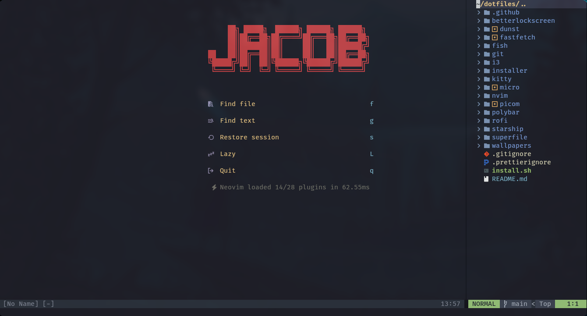
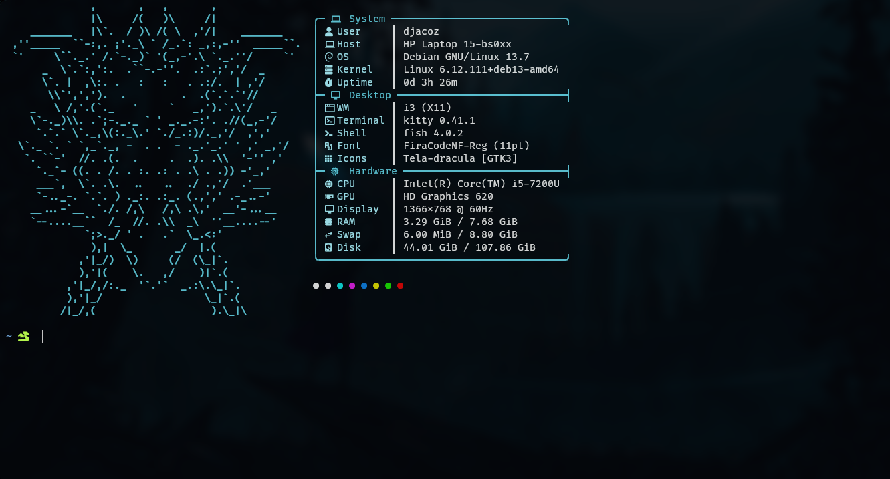

# ☕ Jacob's dotfiles

My personal workflow configuration and customization for **Debian GNU/Linux**. This configuration is carefully chosen for extreme minimalism and to maximize my laptop's performance.

## 📸 Gallery

|  Neovim |  Kitty Terminal |
| :---: | :---: |
|  |  |

## Contents

### System and window management

- i3 + picom configuration
- betterlockscreen configuration
- dunst configuration
- polybar + rofi configuration

### Terminal and shell environment

- Kitty configuration
- Fish configuration
- Starship prompt configuration

### File management and exploration

- Superfile configuration

### Code development and version control

- Neovim configuration
- Micro configuration
- Git configuration

## Installation

You can install and bootstrap the dotfiles onto a fresh Debian/Ubuntu machine using the automated CLI installer:

```bash
curl -fsSL https://raw.githubusercontent.com/JacobEscoto/dotfiles/main/install.sh | bash
```

Or clone and run locally:

```bash
git clone https://github.com/JacobEscoto/dotfiles.git ~/dotfiles
cd ~/dotfiles
./install.sh
```

Flags supported:

- `--dry-run`: Simulate installation without making system changes.
- `--symlinks-only`: Only set up symlinks without installing packages.
- `--packages-only`: Only install packages without modifying symlinks.
- `--no-backup`: Overwrite existing targets without creating backups.
- `-v`: Verbose output.
